<!-- Cards are SVGs rendered by scripts/render.py and refreshed daily by .github/workflows/refresh.yml.
     Edit config.json to change any text, then push: the workflow re-renders everything. -->

  

